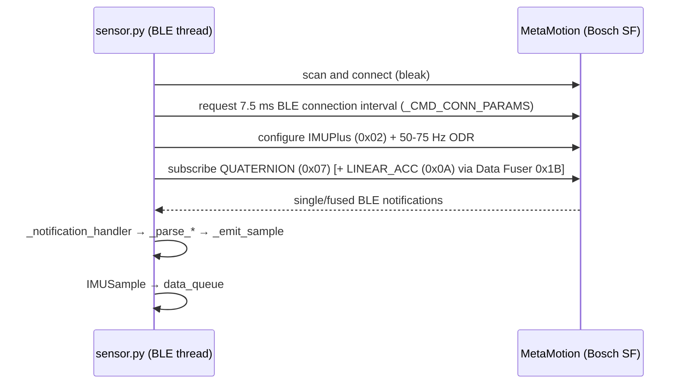
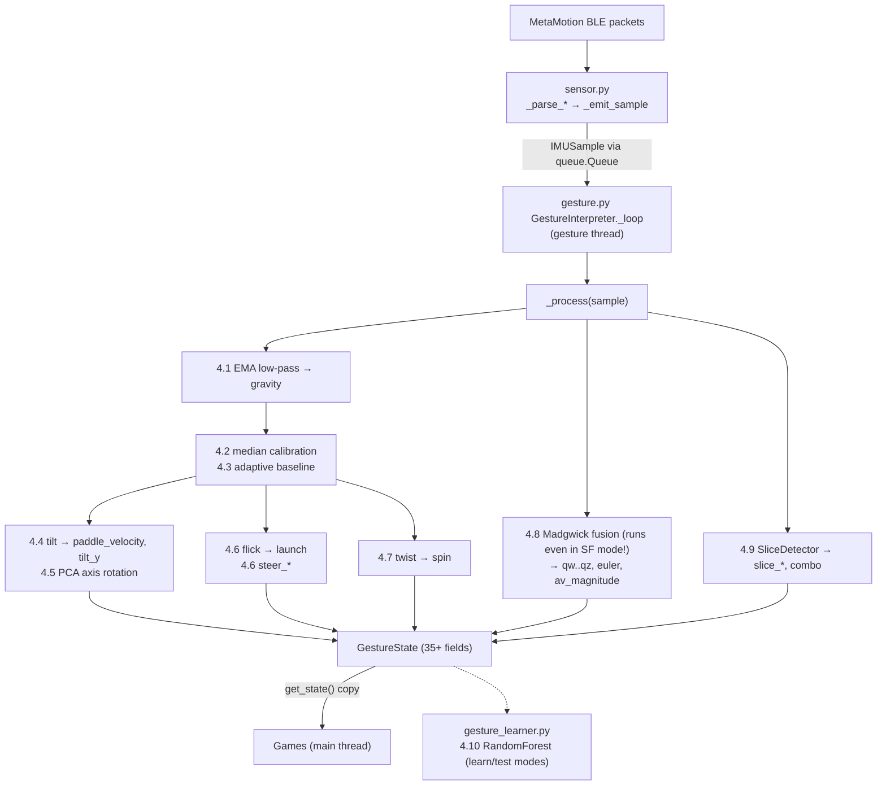
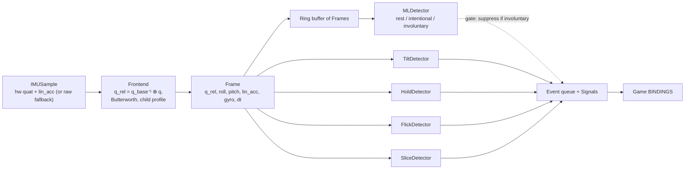
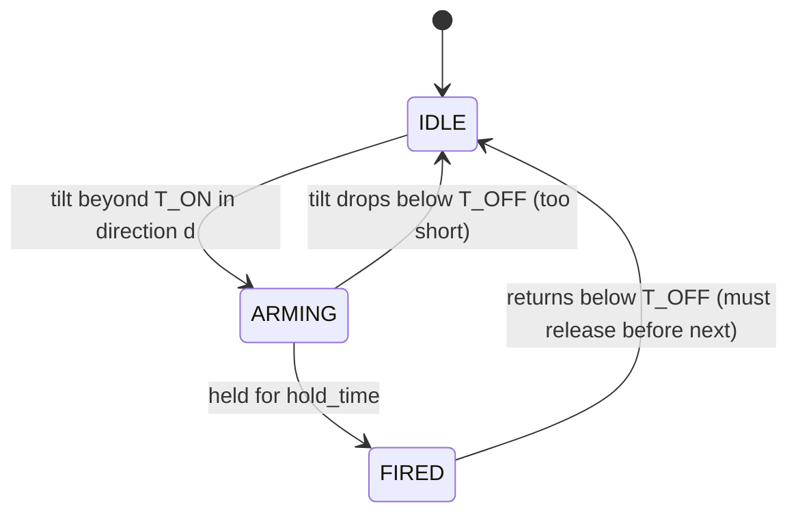
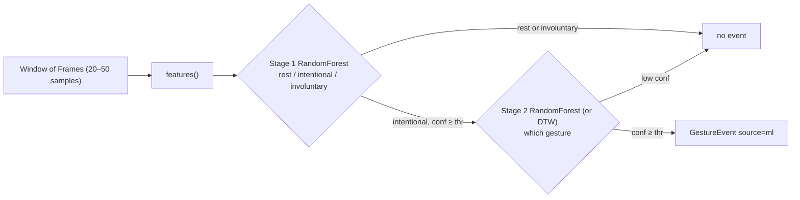
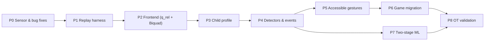

# Gesture System Guide and Implementation Roadmap

**Audience:** developers new to IMU sensors and gesture detection.
**Goal:** understand how the current system works, and build an improved version that is accessible for children with cerebral palsy (CP) and movement disorders.

> [!IMPORTANT]
> This guide is based on reading the code and on research/vendor documentation summaries. It has not been tested with users. All accessibility choices (gestures, thresholds, hold times, mounting location) must be validated with an occupational therapist (OT) and the child. This is not a medical device.

**Companion Learning Guide:** [algorithms-and-math-en-ta.md](algorithms-and-math-en-ta.md) — beginner-friendly, dual-language (**English + தமிழ்**) guide explaining every algorithm and formula used in this project.

**Contents**
1. [Sensor basics & mounting](#1-sensor-basics--mounting)
2. [Sensor interfacing & MetaWear best practices](#2-sensor-interfacing--metawear-best-practices)
3. [The current pipeline (code map)](#3-the-current-pipeline-code-map)
4. [Current algorithms explained](#4-current-algorithms-explained)
5. [What research says about CP and IMUs](#5-what-research-says-about-cp-and-imus)
6. [Target architecture](#6-target-architecture)
7. [New algorithms explained](#7-new-algorithms-explained)
8. [Implementation roadmap](#8-implementation-roadmap)
9. [Glossary](#9-glossary)

---

## 1. Sensor basics & mounting

The MetaMotion is an **IMU** (Inertial Measurement Unit). It contains three sensors:

| Sensor | Measures | Unit | At rest | Good for | Weakness |
|---|---|---|---|---|---|
| **Accelerometer** | Gravity plus your movement acceleration | g (1 g = 9.81 m/s²) | Shows about 1 g pointing "down" | Knowing **tilt** (which way is down) | Noisy, and can't separate gravity from movement |
| **Gyroscope** | How fast you are rotating | °/s (degrees per second) | About 0 | **Fast motion**: flicks, slices, twists | Gives speed, not angle. Integrating it drifts over time. |
| **Magnetometer** | Earth's magnetic field | µT | Points north | Absolute heading (yaw) | Disturbed indoors by metal desks, laptops, wheelchairs |

### Axes
Each sensor gives three numbers, x, y and z, along the sensor's own axes:

```
        z (out of the board)
        │
        │
        └──── x
       /
      y
```

- **Roll** is rotation around x, **pitch** is rotation around y, and **yaw** (heading) is rotation around z.
- When the sensor lies flat and still, the accelerometer reads about `(0, 0, 1)` g. Tilt it sideways and part of that 1 g moves into x. That is how tilt is measured.
- **Mounting location matters:**
  - **Dorsal hand (back of the hand / metacarpals, via strap or glove):** captures true **wrist flexion/extension and radial/ulnar tilt**. Best when the child has selective wrist/hand control.
  - **Wrist / forearm:** captures **forearm rotation (pronation/supination)** well, though it misses wrist flexion/extension.
  - **Alternative mounts (headband, foot, elbow):** because quaternion/gravity orientation works anywhere, mount on whichever joint the child and OT identify as most reliable.
  - Calibration (inverse baseline quaternion in §7.1 + PCA in §4.5) compensates for rotated strap mounting.

### Why on-board sensor fusion (Quaternions)?
- The accelerometer knows where *down* is, but shakes with movement.
- The gyroscope is smooth and fast, but drifts if you integrate it into an angle.
- **Sensor fusion** combines them: the gyroscope gives short-term accuracy and the accelerometer corrects long-term drift.
- Streaming **Quaternions** `(w, x, y, z)` instead of **Euler angles** `(roll, pitch, yaw)` avoids gimbal lock (at ±90° pitch) and sudden ±180° wrap-around jumps during tilted or rotated hand postures.

### Sample rate & BLE throughput
The **sample rate** (`fs`) is the number of readings per second. Every time window and filter constant depends on it.
- BLE bandwidth on MetaWear boards tops out around **100–120 Hz total notifications**. Streaming multiple raw/SF channels at 100 Hz each (e.g., 3 channels × 100 Hz = 300 packets/s) saturates BLE and drops packets.
- **Target:** stream **1–2 fused packets at 50–75 Hz** (e.g., `QUATERNION` alone, or `QUATERNION` + `LINEAR_ACC` packed via the Data Fuser module `0x1B`).

> [!WARNING]
> **The real sample rate in the current code is unverified.** The sensor is configured for 100 Hz ([sensor.py#L59](file:///Users/jerold/dev/Bricks/shared/sensor.py#L59)), a comment says the accelerometer is a "50 Hz clock" ([sensor.py#L853](file:///Users/jerold/dev/Bricks/shared/sensor.py#L853)), and the ML module assumes ~60 Hz ([gesture_learner.py#L65](file:///Users/jerold/dev/Bricks/shared/gesture_learner.py#L65)). **Measure it first** (Phase 0) and define all time constants in **seconds**, not sample counts.

---

## 2. Sensor interfacing & MetaWear best practices

The code talks to the sensor directly over **Bluetooth Low Energy (BLE) GATT**, using the `bleak` library (no native `libmetawear` dependency).



### Decoding a packet (beginner example)
Raw accelerometer readings are three **signed 16-bit integers** (`int16`, range −32768 to 32767), little-endian:

```python
x, y, z = struct.unpack_from("<hhh", payload)   # "<" little-endian, "h" = int16
ax = x * (4.0 / 32768.0)                         # ±4 g range → g per count
```
Example: raw value `8192` → `8192 × 4/32768 = 1.0 g`. The gyroscope uses `500/32768` °/s per count ([sensor.py#L188-L190](file:///Users/jerold/dev/Bricks/shared/sensor.py#L188-L190)). Hardware Sensor Fusion outputs (`QUATERNION`, `EULER_ANGLES`, `LINEAR_ACC`) arrive as IEEE-754 `float32` (`<ffff` / `<fff`).

| Function in `sensor.py` | Purpose |
|---|---|
| [`_parse_acc`](file:///Users/jerold/dev/Bricks/shared/sensor.py#L846) and [`_parse_gyro`](file:///Users/jerold/dev/Bricks/shared/sensor.py#L858) | Raw fallback: int16 → g or °/s |
| [`_parse_sf_corrected_acc`](file:///Users/jerold/dev/Bricks/shared/sensor.py#L870) / [`_parse_sf_corrected_gyro`](file:///Users/jerold/dev/Bricks/shared/sensor.py#L883) | Currently subscribed SF corrected acc/gyro (float32) |
| [`_parse_sf_euler`](file:///Users/jerold/dev/Bricks/shared/sensor.py#L892) | Currently subscribed SF Euler `[heading, pitch, roll]` (float32) |
| [`_emit_sample`](file:///Users/jerold/dev/Bricks/shared/sensor.py#L930) | Packs an [`IMUSample`](file:///Users/jerold/dev/Bricks/shared/sensor.py#L193) into `data_queue` (drops oldest if full) |

### Current `sensor.py` vs MetaWear Best Practices

| Best practice | What `sensor.py` does today | Target change |
|---|---|---|
| **Tight BLE connection interval (7.5–15 ms)** | **Already done.** [`_CMD_CONN_PARAMS`](file:///Users/jerold/dev/Bricks/shared/sensor.py#L48) requests 7.5 ms at [L497](file:///Users/jerold/dev/Bricks/shared/sensor.py#L497). | Keep; measure actual arrival `dt` jitter in Phase 0 (OS BLE stacks may override). |
| **Use `IMUPlus` (6-axis) indoors, not `NDoF` (9-axis)** | **Bug/mismatch.** Comment at [L163](file:///Users/jerold/dev/Bricks/shared/sensor.py#L163) says `IMUPlus (0x02)`, but [`_CMD_SF_MODE`](file:///Users/jerold/dev/Bricks/shared/sensor.py#L169) sends `0x01` (`NDOF`). | Switch to `0x02` (`IMUPlus`) so indoor metal/electronics don't corrupt orientation. |
| **Stream `QUATERNION` (`0x07`) instead of `EULER` (`0x08`)** | Subscribes to `EULER_ANGLES` (`0x08`), `CORRECTED_ACC` (`0x04`), `CORRECTED_GYRO` (`0x05`) — **3 streams (~300 pkt/s)** — and ignores quaternion on host. | Subscribe to `QUATERNION` (`0x07`), store `hw_qw/qx/qy/qz` in `IMUSample`, and skip host Madgwick when `hw_fusion_valid` is True. |
| **Data Fuser (`0x1B`) + 50–75 Hz cap** | Not used; 3 separate SF notifications saturate BLE. | Pack `QUATERNION` (`0x07`) + `LINEAR_ACC` (`0x0A`) (and `CORRECTED_GYRO` if needed, or derive $\omega$ from $\Delta q/\Delta t$) at 50–75 Hz. |
| **On-board Data Processors (Peak/Pulse/Threshold)** | Not used; host-side detection. | **Keep host-side for CP.** Hardware thresholds on the Cortex-M4 cannot separate CP spasms/tremors from intentional movement or run per-child hysteresis/ML. |
| **1 USB BLE dongle per 2–3 sensors** | Single sensor currently. | Keep note for Phase 8+ if adding a 2nd trunk/shoulder sensor to detect compensation. |

### Timestamps
- `IMUSample.timestamp` is the PC `time.monotonic()` when the BLE packet **arrived**, not when it was sampled.
- BLE delivers packets in bursts, causing `dt` jitter. Phase 0 measures mean and std of `dt` (and evaluates fixed `1/fs` vs smoothed `dt` for derivative math).

---

## 3. The current pipeline (code map)



| Stage | Code |
|---|---|
| Thread loop and disconnect detection | [`_loop`](file:///Users/jerold/dev/Bricks/shared/gesture.py#L362) |
| All gesture math | [`_process`](file:///Users/jerold/dev/Bricks/shared/gesture.py#L391) |
| Tuning knobs | [`GestureConfig`](file:///Users/jerold/dev/Bricks/shared/gesture.py#L49), with presets at [L112-129](file:///Users/jerold/dev/Bricks/shared/gesture.py#L112-L129) |
| Output | `GestureState` ([gesture.py#L134](file:///Users/jerold/dev/Bricks/shared/gesture.py#L134)) |
| Fusion (software fallback) | [`MadgwickFilter`](file:///Users/jerold/dev/Bricks/shared/fusion_processor.py#L36) (currently called at [gesture.py#L553](file:///Users/jerold/dev/Bricks/shared/gesture.py#L553) on *every* sample) |
| Slice | [`SliceDetector`](file:///Users/jerold/dev/Bricks/shared/gesture_detector.py#L42) |
| ML | [`FeatureExtractor`](file:///Users/jerold/dev/Bricks/shared/gesture_learner.py#L151) and [`GestureModel`](file:///Users/jerold/dev/Bricks/shared/gesture_learner.py#L484) |

**Engine vs detector.** The *engine* (`GestureInterpreter`) owns the thread, filtering, calibration, config and output. A *detector* (`SliceDetector`) is one small algorithm. It takes samples in and gives an event or nothing back, with no thread and no state publishing.

---

## 4. Current algorithms explained

Each algorithm is explained in four parts: **problem → idea → math → code**, plus pitfalls. (For full step-by-step worked examples in English + Tamil, see [algorithms-and-math-en-ta.md](algorithms-and-math-en-ta.md).)

### 4.1 Exponential Moving Average (EMA) low-pass filter: extracting gravity
- **Problem:** the accelerometer measures gravity plus movement. Tilt only needs gravity.
- **Idea:** gravity changes slowly, while movement changes fast. Keep the slow part.
- **Math:** each new output is a blend of the new reading and the previous output:

$$
y_n = \alpha \, x_n + (1-\alpha)\, y_{n-1}
$$

- With α = 0.05, each new sample contributes 5% and history contributes 95%.
- **Time constant** (how long it takes to react to ~63% of a change):

$$
\tau = \frac{\Delta t\,(1-\alpha)}{\alpha}, \qquad f_c = \frac{1}{2\pi\tau}
$$

- At 100 Hz (Δt = 0.01 s): τ = 0.19 s and fc ≈ **0.84 Hz**. At 50 Hz: τ = 0.38 s and fc ≈ 0.42 Hz.
- **Code:** [gesture.py#L398-L401](file:///Users/jerold/dev/Bricks/shared/gesture.py#L398-L401)

> [!NOTE]
> The code comment says "≈ 2 Hz cutoff". By the formula it is about 0.84 Hz at 100 Hz. Voluntary movement is about 0.3–2 Hz (section 5), so this filter **lags and partly removes intentional movement**. That is why section 7.1 replaces raw-accel tilt with fused quaternion orientation.

### 4.2 Median calibration: finding "neutral"
- **Problem:** "flat" differs for every child and every way the sensor is strapped on.
- **Idea:** record about 1 s at rest. The typical gravity vector is "neutral".
- **Why median, not mean?** The median is the middle value after sorting, so a few tremor spikes can't drag it. Example: for `[1.0, 1.0, 1.1, 1.0, 5.0]` the mean is 1.82 but the median is **1.0**.
- **Code:** [gesture.py#L408-L430](file:///Users/jerold/dev/Bricks/shared/gesture.py#L408-L430)

### 4.3 Adaptive baseline: following posture drift (washout)
- **Problem:** the child's resting posture shifts with fatigue or spasticity. The paddle would slowly drift.
- **Idea:** when the arm is *nearly still* (gyro magnitude below 45°/s), slowly move the neutral point toward the current position.
- **Math:** another EMA, very slow (`ar = 0.002`), gated by the gyroscope:

$$
\text{if } \|\omega\| < 45: \quad \text{cal} \leftarrow ar\cdot \text{smooth} + (1-ar)\cdot \text{cal}
$$

- The time constant is Δt/ar = 0.01/0.002 = **5 s** at 100 Hz.
- **Pitfall:** a child holding a tilt deliberately and slowly (without rotating) gets "re-centred" after a few seconds, so the paddle stops. Pause adaptation during `ARMING` in hold/dwell gestures (section 7.4).
- **Code:** [gesture.py#L431-L440](file:///Users/jerold/dev/Bricks/shared/gesture.py#L431-L440)

### 4.4 Dead zone plus linear mapping: tilt to paddle speed
- **Problem:** turn a tilt into a speed from −1 to 1. Ignore tiny wobbles.
- **Idea:** below a threshold, output 0. Above it, scale linearly up to a maximum:

$$
v = \operatorname{sign}(t)\cdot \min\!\left(1,\; \frac{|t| - thr}{t_{max} - thr}\right) \quad \text{if } |t| \ge thr, \text{ else } 0
$$

- Example: `thr = 0.05 g` and `t_max = 0.5 g`. A tilt of 0.275 g gives `(0.275 − 0.05)/0.45 = 0.5` (half speed).
- **Pitfall:** without *hysteresis* (section 7.3), a tremor sitting right at the threshold makes the paddle flicker on and off.
- **Code:** [gesture.py#L470-L488](file:///Users/jerold/dev/Bricks/shared/gesture.py#L470-L488)

### 4.5 PCA axis alignment: "which way does this child naturally move?"
- **Problem:** a child may only move diagonally, because of contracture or a rotated strap. The game wants a clean left/right axis.
- **Idea:** record 2.5 s of natural swinging and find the **direction with the most spread** (the first principal component, PCA). Then rotate coordinates so this direction becomes "x".
- **Math:** build the 2×2 covariance from the tilt points `(x, y)`:

$$
c_{xx}=\sum (x-\bar x)^2,\quad c_{yy}=\sum (y-\bar y)^2,\quad c_{xy}=\sum (x-\bar x)(y-\bar y)
$$

$$
\theta = \tfrac12 \operatorname{atan2}(2c_{xy},\; c_{xx}-c_{yy})
$$

$$
x' = x\cos\theta + y\sin\theta,\qquad y' = -x\sin\theta + y\cos\theta
$$

- **Picture it:** the points form a tilted ellipse; θ is the angle of the ellipse's long axis.
- **Code:** [`align_functional_axis`](file:///Users/jerold/dev/Bricks/shared/gesture.py#L330-L353), applied at [L464-468](file:///Users/jerold/dev/Bricks/shared/gesture.py#L464-L468)

### 4.6 Sliding-window peak plus cooldown: flick (launch) and flick-to-steer
- **Problem:** detect a quick wrist snap.
- **Idea:** keep the last N gyroscope readings (*sliding window*). If the largest exceeds a threshold, fire, then wait for a *cooldown* period.

```python
window.append(gy)                         # deque(maxlen=6) → last 60 ms at 100 Hz
if len(window) == 6 and max(abs(v) for v in window) > 200 and now - last > 0.4:
    launch = True; last = now
```

- **Flick-to-steer** works the same way on `gx` (left/right) and `gy` (up/down), using the **sign** of the peak for direction.
- **Pitfalls:**
  - `launch` uses `abs()`, so a **downward** jerk or spasm also launches.
  - `launch` is a one-frame boolean; a slow game frame can miss it. Section 6 replaces it with an event queue.
- **Code:** flick at [L492-502](file:///Users/jerold/dev/Bricks/shared/gesture.py#L492-L502); steer at [L504-533](file:///Users/jerold/dev/Bricks/shared/gesture.py#L504-L533)

### 4.7 Twist to spin
- Dead-zone mapping applied to smoothed `gz`. Spin is 0 below 30°/s, and `(|gz| − 30)/200` above it, clamped to ±1.
- ASTRA sets the dead zone to 999, disabling spin.
- **Code:** [L540-546](file:///Users/jerold/dev/Bricks/shared/gesture.py#L540-L546)

### 4.8 Sensor fusion: Bosch hardware SF & Madgwick fallback
- **Problem:** get a stable orientation from a noisy accelerometer and a drifting gyroscope.
- **Quaternion in one sentence:** four numbers `(w, x, y, z)` representing a 3D rotation without gimbal lock. Convert to roll, pitch and yaw only when needed.
- **Target path (hardware Bosch SF in `IMUPlus`):** read `(qw, qx, qy, qz)` directly from `QUATERNION` (`0x07`) on the MetaMotion ARM Cortex-M4/Bosch BHI/BMI fusion engine — zero Madgwick math on the host.
- **Fallback path (software [`MadgwickFilter`](file:///Users/jerold/dev/Bricks/shared/fusion_processor.py#L36) when raw mode is active):**
  1. **Predict with gyro:** $\dot q_\omega = \tfrac12\, q \otimes (0, \omega_x, \omega_y, \omega_z)$
  2. **Correct with accel:** compute gravity alignment error $f(q)$ and take one gradient-descent step $\nabla f / \|\nabla f\|$.
  3. **Blend:** $q \leftarrow q + (\dot q_\omega - \beta \nabla f / \|\nabla f\|)\Delta t$, then normalise $q$ ($\beta = 0.033$).
- **Quaternion to Euler angles:** [`get_euler_deg`](file:///Users/jerold/dev/Bricks/shared/fusion_processor.py#L163)

  $$\text{roll}=\operatorname{atan2}(2(wx+yz),\,1-2(x^2+y^2)),\quad \text{pitch}=\arcsin(2(wy-zx))$$
- **Linear acceleration (movement only):** subtract rotated gravity from raw accel ([`get_linear_accel`](file:///Users/jerold/dev/Bricks/shared/fusion_processor.py#L198)), or read `LINEAR_ACC` (`0x0A`) from hardware SF. Currently computed on host but **not published**.
- **Code:** [fusion_processor.py#L55-L157](file:///Users/jerold/dev/Bricks/shared/fusion_processor.py#L55-L157), [gesture.py#L553-565](file:///Users/jerold/dev/Bricks/shared/gesture.py#L553-L565)

### 4.9 SliceDetector: direction classification
1. **Magnitude:** `av = √(gx² + gy² + gz²)`.
2. **Window:** last 8 samples. **Trigger:** peak `av >= 150°/s` and 0.25 s cooldown elapsed.
3. **Direction:** average `gz` and `gy` over the window, with a **1.5× dominance ratio**:
   - `|gz| > 1.5·|gy|` → `left` or `right`.
   - `|gy| > 1.5·|gz|` → `up` or `down`.
   - Otherwise → `diagonal_*`.
4. **Speed:** `(peak − 150) / 300`, clamped to 0–1.
5. **Combo:** count slice timestamps within the last 1.5 s.
- **Code:** [gesture_detector.py#L63-L176](file:///Users/jerold/dev/Bricks/shared/gesture_detector.py#L63-L176). Comment and code disagree on the sign for `"up"` (L136 vs L155).

### 4.10 The ML pipeline: RandomForest gesture recognition
**Step A: windowing.** A 60-frame rolling buffer; 36 frames **centred on the motion peak** are extracted ([L65-69](file:///Users/jerold/dev/Bricks/shared/gesture_learner.py#L65-L69)).

**Step B: 38 features** ([`FeatureExtractor.extract`](file:///Users/jerold/dev/Bricks/shared/gesture_learner.py#L174)): per-channel mean/std/max-abs (18), gyro magnitude stats (4), dominant gyro angle (1), gyro & accel RMS (2), gyro jerk (3), zero crossings (2), peak timing fraction (1), signed area (3), dominant axis ratio (1), Euler roll/pitch mean (2), gyro magnitude at peak (1).

**Step C: RandomForest classifier.** 60 decision trees (max depth 8), each trained on a bootstrap sample + random feature subsets. `predict_proba` returns the vote fraction per class as **confidence** ([`GestureModel.train`](file:///Users/jerold/dev/Bricks/shared/gesture_learner.py#L499)).

**Step D: abstain + smoothing.** Abstains below threshold (0.55 standard, 0.45 accessible); smooths via majority vote over 4–6 frames ([`GestureProfile`](file:///Users/jerold/dev/Bricks/shared/gesture_learner.py#L88)).

**Step E: validation.** Session-aware stratified k-fold cross-validation ([`GestureValidator`](file:///Users/jerold/dev/Bricks/shared/gesture_learner.py#L594)).

> [!WARNING]
> `PROFILE_ACCESSIBLE` sets `erratic_std_max=999` ([L111-114](file:///Users/jerold/dev/Bricks/shared/gesture_learner.py#L111-L114)), so spasms are recorded **as if they were gestures**. Section 7.8 records them as a separate `involuntary` class instead.

---

## 5. What research says about CP and IMUs

Research areas that match this project:
- **IMU exergames for upper-limb rehab:** calibrate to limited ROM, scale difficulty adaptively, and watch for **compensation** (using trunk/shoulder instead of wrist).
- **Intentional vs involuntary movement in dyskinetic CP:** features include RMS, jerk, entropy, and wavelet/FFT band energy; models include SVM, RandomForest, LSTM, and 1D-CNN with classes *rest / intentional / involuntary*.
- **Personalized gestures (HCI):** standard gesture sets fail for motor impairments; user-defined gestures from reliable movements work better.
- **Assistive technology input:** dwell times, hysteresis/adjustable thresholds, and switch-style input.

### Frequency bands (approximate, from research summaries)

| Movement | Typical frequency |
|---|---|
| Voluntary, purposeful movement | ~0.3–2 Hz |
| Dystonia (slow twisting, posturing) | ~0–1 Hz |
| Choreoathetosis (jerky, writhing) | ~1–4 Hz, components up to ~7 Hz |
| Tremor | ~4–12 Hz |

> [!CAUTION]
> **Critical insight:** A frequency filter only removes **tremor** (4–12 Hz). Dyskinetic movement (0–4 Hz) **overlaps voluntary movement**, so no frequency filter alone can separate them. You need **windowed features** (jerk, entropy, speed peaks) plus a **per-child ML model** with an `involuntary` class (sections 7.7–7.8). Verify these ranges against original papers.

**Search terms** for PubMed, IEEE Xplore, ACM Digital Library:
- `"dyskinetic cerebral palsy" AND (accelerometer OR IMU) AND classification`
- `"cerebral palsy" AND "serious game" AND "inertial sensor"`
- `"personalized gesture recognition" AND "motor impairment"`

---

## 6. Target architecture



### 6.1 Core types (the only things games need to know)

```python
class Gesture(Enum):
    # continuous signals (read via signals())
    TILT = auto(); POINTER = auto()
    # accessible gestures (default in ASTRA)
    HOLD_LEFT = auto(); HOLD_RIGHT = auto(); HOLD_UP = auto(); HOLD_DOWN = auto()
    DWELL = auto(); ANY_MOVE = auto(); STILL = auto()
    # standard gestures
    FLICK_UP = auto(); FLICK_DOWN = auto(); FLICK_LEFT = auto(); FLICK_RIGHT = auto()
    SLICE = auto(); TWIST_CW = auto(); TWIST_CCW = auto(); SHAKE = auto()

@dataclass(frozen=True)
class GestureEvent:
    gesture: Gesture
    strength: float = 1.0      # 0..1
    confidence: float = 1.0    # 1.0 for rules, model proba for ML
    direction: str = ""        # e.g. slice direction
    source: str = "rule"       # "rule" | "ml"
    t: float = 0.0

@dataclass(frozen=True)
class Frame:
    t: float; dt: float
    qw: float; qx: float; qy: float; qz: float    # relative to child's q_base
    roll: float; pitch: float; yaw: float         # degrees, extracted from q_rel
    gx: float; gy: float; gz: float               # °/s
    lin_ax: float; lin_ay: float; lin_az: float   # g, gravity removed
    calibrated: bool

class Detector(Protocol):
    name: str
    def update(self, f: Frame) -> list[GestureEvent]: ...
    def reset(self) -> None: ...
```

### 6.2 Engine loop (the whole engine fits on a screen)

```python
def _process(self, sample):
    frame = self.frontend.process(sample)          # q_rel + Butterworth + profile ROM
    self.buffer.append(frame)
    events = []
    for d in self.detectors:                       # plug-ins
        events += d.update(frame)
    events = self.gate.filter(events, self.buffer)  # drop if ML/spasm gate says involuntary
    with self._lock:
        self._events.extend(events)                # queue: never missed
        self._signals = self.frontend.signals()    # continuous: tilt, pointer
```

### 6.3 What games use

```python
BINDINGS = {Gesture.FLICK_UP: self.launch_ball, Gesture.HOLD_UP: self.launch_ball}
for e in gestures.poll():                 # drain all events since last frame
    if e.gesture in BINDINGS: BINDINGS[e.gesture](e)
tilt = gestures.signals().tilt_x          # -1..1 continuous
```

**Modes become profiles.** ASTRA vs VEERA becomes a set of detector settings plus game assists, loaded from the child's profile. It is no longer scattered `if mode == "accessible"` code.

---

## 7. New algorithms explained

### 7.1 Baseline Quaternion Normalization + ROM Tilt (replaces §4.1 & Euler subtraction)
- **Problem:** raw EMA tilt lags (0.2–0.4 s) and depends on mounting; subtracting raw Euler angles (`roll - roll_0`) breaks when the sensor starts tilted or wraps around ±180°.
- **Idea (MetaWear best practice):** capture a neutral resting quaternion $q_{\text{base}}$ during calibration. For every incoming quaternion $q$ (from hardware `IMUPlus` `0x07` or software Madgwick fallback), multiply by the **inverse** (conjugate, since unit quaternion) of $q_{\text{base}}$:

$$
q_{\text{rel}} = q_{\text{base}}^{-1} \otimes q, \qquad q_{\text{base}}^{-1} = (w_0, -x_0, -y_0, -z_0)
$$

- Now `q_rel = (1, 0, 0, 0)` at the child's neutral pose, regardless of whether the sensor sits on the dorsal hand, wrist, head, or foot at an awkward resting angle!
- Convert `q_rel` to `(roll, pitch)` (and apply PCA angle $\theta$ if needed), then scale by the child's per-side **range of motion (ROM)**:

$$
\text{tilt}_x = \operatorname{clamp}\!\left(\frac{\text{roll}_{\text{rel}}}{\text{ROM}_{right}},\,-1,\,1\right) \quad(\text{use } \text{ROM}_{left} \text{ when } \text{roll}_{\text{rel}} < 0)
$$

### 7.2 Butterworth low-pass filter (cleaner than EMA)
- **Problem:** the EMA rolls off slowly. It blurs useful motion and still leaks tremor.
- **Idea:** a **2nd-order Butterworth** filter is flat below the cutoff and drops steeply above it.
  - Use **about 3 Hz** on control signals (tilt, pointer): keeps voluntary motion (< 2 Hz) and removes tremor (4–12 Hz).
  - Use **about 10 Hz** on data for feature extraction: removes only electrical noise.
- **Math:** a *biquad* difference equation using the last 2 inputs and outputs:

$$
y_n = b_0x_n + b_1x_{n-1} + b_2x_{n-2} - a_1y_{n-1} - a_2y_{n-2}
$$

```python
# coefficients once (scipy): b, a = scipy.signal.butter(2, fc, fs=fs)
class Biquad:
    def __init__(self, b, a): self.b, self.a = b, a; self.x1=self.x2=self.y1=self.y2=0.0
    def __call__(self, x):
        b0,b1,b2 = self.b; _,a1,a2 = self.a
        y = b0*x + b1*self.x1 + b2*self.x2 - a1*self.y1 - a2*self.y2
        self.x2, self.x1, self.y2, self.y1 = self.x1, x, self.y1, y
        return y
```
- **Trade-off:** a 3 Hz 2nd-order filter adds ~50–80 ms delay, much less than the current EMA.

### 7.3 Hysteresis (Schmitt trigger): stops flicker
- **Problem:** a value hovering at the threshold toggles ON, OFF, ON, OFF.
- **Idea:** use two thresholds. Turn **on** above the high one (`T_ON`) and turn **off** only below the low one (`T_OFF`).

```python
if not active and abs(x) > T_ON:   active = True     # e.g. T_ON  = 0.25
elif active and abs(x) < T_OFF:    active = False    # e.g. T_OFF = 0.15
```

- Set `T_ON` above the child's resting tremor amplitude (section 7.6).

### 7.4 Hold or dwell detector: a spasm-robust "button"
- **Problem:** flicks require fast movement, and spasms look like flicks.
- **Idea:** count a gesture only if the child **holds** a direction for `hold_time` seconds. A spasm is brief, so it can't hold.



```python
class HoldDetector:
    def update(self, f):
        x = f.tilt_x
        if self.state == "IDLE" and abs(x) > self.t_on:
            self.state, self.start, self.dir = "ARMING", f.t, sign(x)
        elif self.state == "ARMING":
            if abs(x) < self.t_off or sign(x) != self.dir: self.state = "IDLE"
            elif f.t - self.start >= self.hold_time:
                self.state = "FIRED"
                return [GestureEvent(HOLD_RIGHT if self.dir > 0 else HOLD_LEFT, t=f.t)]
        elif self.state == "FIRED" and abs(x) < self.t_off:
            self.state = "IDLE"
        return []
```

- Show a **progress ring** while in `ARMING`, so the child sees the hold filling up.
- Pause the adaptive baseline (section 4.3) while `ARMING`, otherwise it re-centres the hold away.
- **DWELL** is the same idea for a pointer: it fires if the pointer stays inside a target for `hold_time`.

### 7.5 Spasm rejection gate (rule-based, before ML exists)
- **Idea:** intentional movement is *smooth and sustained*; spasms are *sudden and short*. Over a 0.3–0.5 s window check:
  1. **Jerk** (`|lin_aₙ − lin_aₙ₋₁| / dt`): a very high peak jerk flags a spasm.
  2. **Duration above threshold:** a burst shorter than ~150 ms flags a spasm.
- Discard discrete events from flagged windows. Thresholds come from the child's profile (§7.6).

### 7.6 Per-child calibration profile
A guided 2–3 minute session saved to `data/profiles/{name}.json` (including `mount_location`: `dorsal_hand` / `wrist` / `head` / `foot` / `elbow`).

| Step | What the child does | What we compute | Algorithm |
|---|---|---|---|
| 1. Rest | Relax for 10 s | Neutral quaternion `q_base`; **tremor amplitude** | Normalised mean/median quaternion at rest; RMS of 3 Hz-filtered deviation = tremor |
| 2. Reach | Tilt comfortably each direction, 3× | **ROM** for left, right, up, down | **90th percentile** of relative angle (ignores one-off spasm spikes) |
| 3. Natural swing | Swing for 3 s | Movement axis θ | PCA (section 4.5) |
| 4. Hold | Hold a tilt comfortably | `hold_time` | Median hold duration × 0.6 |
| 5. React | Move when screen flashes | Reaction time → cooldowns | Median latency |

Derived settings: `T_ON = max(0.15, 3 × tremor_rms / ROM)`, `T_OFF = 0.6 × T_ON`, `cooldown = max(0.5, 1.5 × reaction_time)`.

### 7.7 Features for intentional vs involuntary movement
Compute over a 1–2 s window (20–50+ samples at 50 Hz):

| Feature | How to compute | Why it helps |
|---|---|---|
| **RMS jerk** | $\sqrt{\text{mean}((\Delta a / \Delta t)^2)}$ | Spasms and chorea are jerky |
| **Band energy ratio** | FFT energy in 0.3–2 Hz ÷ total energy | Voluntary motion concentrates below 2 Hz |
| **Spectral entropy** | Normalised FFT power $p_k$: $-\sum p_k \log p_k / \log K$ | Low = regular/purposeful; high = chaotic |
| **Number of speed peaks** | Local maxima in gyro/angular-speed magnitude | Smooth reaches have ~1 peak; dyskinesia has many |
| **Linear acceleration stats** | mean, std of `lin_a` | Separates translation from rotation |
| **Sample entropy** (optional) | Predictability of sub-patterns | Low = predictable; high = irregular |

```python
P = np.abs(np.fft.rfft(x * np.hanning(len(x))))**2
freqs = np.fft.rfftfreq(len(x), d=1/fs)
low = P[(freqs >= 0.3) & (freqs <= 2)].sum() / P.sum()
p = P / P.sum(); spectral_entropy = -(p * np.log(p + 1e-12)).sum() / np.log(len(p))
```

### 7.8 Two-stage ML: RandomForest vs DTW vs 1D-CNN



- **Why keep host-side RandomForest (+ optional DTW) instead of 1D-CNN or on-board Cortex-M4 triggers?**
  - **On-board Data Processors** only do simple peak/threshold checks and can't distinguish spasms from intentional gestures.
  - **1D-CNN** generally needs hundreds/thousands of samples to train reliably, whereas one child can only comfortably record ~10–30 samples per class.
  - **RandomForest** trains in milliseconds on CPU with small per-child datasets and gives calibrated vote-fraction confidence (`predict_proba`) for safe abstaining.
  - **DTW (Dynamic Time Warping)** is a good optional complement for Stage 2 when a child defines 1–2 unique custom motion arcs with only 3–5 examples (pair with time-normalization so slow and fast repetitions match).
- **Data collection & gating:** record spasms as the `involuntary` class (fixing `erratic_std_max=999`). Run inference only when motion passes a rest gate; fall back to rules below minimum sample counts or low confidence.

### 7.9 Orientation pointer (replaces gyro-integration cursors)
- **Problem:** Fruit Ninja and Villain Slicer integrate `gz` and `gy` ([fruit_ninja#L849-850](file:///Users/jerold/dev/Bricks/games/fruit_ninja/game.py#L849-L850)), causing drift and wrist-roll axis errors.
- **Idea:** map relative quaternion orientation (`roll_rel`, `pitch_rel` from `q_rel`) directly to screen coordinates within the child's ROM:

$$
x_{px} = \tfrac{W}{2}\,(1 + \text{tilt}_x), \qquad y_{px} = \tfrac{H}{2}\,(1 - \text{tilt}_y)
$$

- Smooth with the 3 Hz Butterworth filter; add recentre (hold still 2 s) and optional gentle target snapping.

### 7.10 Direction-aware flick (fix)
Use the **signed** peak, not `abs`:

```python
peak = max(window, key=abs)
if peak < -thr: emit(FLICK_UP)      # sign convention: verify with replay data
elif peak > thr: emit(FLICK_DOWN)
```

---

## 8. Implementation roadmap

Each phase keeps all games working. Acceptance criteria are measurable on **replay data** (Phase 1).



### Phase 0: sensor fixes, measurement & quick bugs
| Task | File | Done when |
|---|---|---|
| Log real sample rate and `dt` jitter (mean & std) | `sensor.py` | Actual Hz & jitter known; constants in seconds |
| Switch SF mode from `NDOF (0x01)` to `IMUPlus (0x02)` | `sensor.py#L169` | Indoor heading/orientation stable near laptops/desks |
| Subscribe to `QUATERNION (0x07)` (+ `LINEAR_ACC 0x0A` / Data Fuser `0x1B`) at 50–75 Hz; add `hw_qw..qz` to `IMUSample` | `sensor.py` | Single/fused packet stream stays < 100 Hz BLE cap with 0 drops |
| Skip host `MadgwickFilter` when `hw_fusion_valid` is True | `gesture.py#L553` | Host CPU drops; `qw..qz` come directly from hardware SF |
| Direction-aware `launch` (§7.10) | `gesture.py#L492` | Downward jerk no longer launches |
| Fix slice `"up"` comment vs code | `gesture_detector.py#L136,155` | Test confirms sign |
| Remove unused `SliceDetector` in villain_slicer | `villain_slicer/game.py#L150` | Clean |
| Fix EMA "2 Hz" comment (~0.84 Hz at 100 Hz) | `gesture.py#L64` | Accurate comment |
| Haptic `vibrate()` on accepted gestures | games | Tactile confirmation works |

### Phase 1: replay harness (foundation)
1. Add `shared/recorder.py` writing each `IMUSample` (including `hw_qw..qz`) as JSON lines (`{"t":..., ...}`).
2. Add `tests/replay.py` with `replay(path) -> list[GestureEvent]` (no BLE, no pygame).
3. Record `rest.jsonl`, `tilt_left_right.jsonl`, `flicks_up.jsonl`, `slices.jsonl`, and (with consent) `tremor.jsonl` and `spasm.jsonl`.
4. Assert expected events and **zero events** on rest/spasm files.

**Done when:** `pytest` runs gesture tests without hardware.

### Phase 2: frontend (§6 & §7.1–7.2)
1. Create `shared/frontend.py` with `Frontend.process(sample) -> Frame`.
2. Use hardware `QUATERNION` (Madgwick fallback in raw mode), compute $q_{\text{rel}} = q_{\text{base}}^{-1} \otimes q$, extract relative `roll, pitch, yaw`.
3. Add 2nd-order Butterworth `Biquad` (3 Hz control, 10 Hz features) and publish `lin_a*`.
4. Fill legacy `GestureState` fields from `Frame` so games stay untouched.

**Done when:** replay tests pass and tilt lag < 100 ms (vs ~200–400 ms today).

### Phase 3: per-child profile (§7.6)
1. Add `ChildProfile` JSON save/load in `data/profiles/` (stores `q_base`, `mount_location`, per-side ROM, `tremor_rms`, `T_ON`, `T_OFF`, `hold_time`, `cooldown`).
2. Add 5-step guided calibration screen reusing [`username_screen`](file:///Users/jerold/dev/Bricks/shared/username_screen.py).
3. Load profile parameters into frontend and detectors.

**Done when:** two recorded users yield distinct thresholds and zero rest false triggers.

### Phase 4: detector plug-ins and event queue (§6)
1. Add `shared/gestures/types.py` (`Gesture`, `GestureEvent`, `Frame`, `Detector`).
2. Extract `TiltDetector`, `FlickDetector`, `SteerDetector`, `TwistDetector`, `SliceDetector`.
3. Add `poll()` and `signals()` on engine; keep `get_state()` as compatibility shim.

**Done when:** replay tests pass and new detectors plug in without editing `_process`.

### Phase 5: accessible gestures (§7.3–7.5)
1. `HoldDetector` and `DwellDetector` with hysteresis (pausing adaptive baseline during `ARMING`).
2. `SpasmGate` (jerk + minimum duration).
3. `AnyMoveDetector` (single-switch trigger) and one-axis dominant-lock mode.

**Done when:** `spasm.jsonl` produces zero events; each `hold_*.jsonl` produces one event.

### Phase 6: game migration
Order: **Home → Bricks → Snake → Fruit Ninja & Villain Slicer** (`Pointer`, §7.9) **→ remaining games**.
- Each game declares `BINDINGS` + a gesture legend shown on Home.
- Replace `if mode == "accessible"` checks with profile settings + game assists (auto-aim, no-fail, pause on idle).

**Done when:** no game reads `abs_gx/gy/gz` or `paddle_velocity` directly.

### Phase 7: two-stage ML (§7.7–7.8)
1. Extract pure `features(frames) -> np.ndarray` shared by training & live inference; add §7.7 features (RMS jerk, FFT band ratio, spectral entropy, speed peaks, `lin_acc`) and bump `SCHEMA_VERSION`.
2. Add `rest / intentional / involuntary` carer tap-to-label in recorder.
3. Implement Stage 1 + Stage 2 RandomForest (plus optional few-shot DTW) in `MLDetector`.
4. Report **false-trigger rate (events/min)** during rest and spasms in validation.

**Done when:** false-trigger rate during spasms drops below rules-only on held-out sessions without losing gesture recall.

### Phase 8: feedback, fatigue & validation
- Live "what the sensor sees" indicator, hold progress ring, sound + haptic confirmation.
- Session fatigue tracking (success rate/min → offer easier profile or break).
- Optional 2nd trunk sensor (with dedicated USB BLE dongle) to detect shoulder/trunk compensation.
- OT-supervised sessions fed back into the replay library.

---

## 9. Glossary

| Term | Meaning |
|---|---|
| **IMU** | Inertial Measurement Unit: accelerometer + gyroscope (+ magnetometer) |
| **IMUPlus vs NDoF** | MetaWear fusion modes: `IMUPlus` = 6-axis (acc+gyro, drift-free tilt, immune to indoor magnets); `NDoF` = 9-axis (+ compass) |
| **Data Fuser (`0x1B`)** | MetaWear module that packs multiple sensor outputs (e.g., Quaternion + Linear Acc) into one BLE packet |
| **Dorsal hand mount** | Sensor strapped to back of hand (metacarpals); captures wrist flexion/extension better than forearm/wrist strap |
| **Sample rate (`fs`)** | Readings per second (Hz) |
| **EMA / Butterworth** | Low-pass filters; Butterworth gives a sharper cutoff with less lag on voluntary motion |
| **Hysteresis** | Separate high-on (`T_ON`) and low-off (`T_OFF`) thresholds to prevent flicker |
| **Quaternion & Inverse** | 4D rotation `(w,x,y,z)` without gimbal lock; `q_base⁻¹ ⊗ q` makes all angles relative to neutral |
| **Linear acceleration** | Acceleration with gravity removed (movement only) |
| **Jerk** | Rate of change of acceleration (`Δa / Δt`); high in spasms |
| **FFT & Spectral entropy** | Frequency decomposition and disorder metric across frequencies |
| **PCA** | Finds the primary movement axis from natural swings |
| **RandomForest / DTW / 1D-CNN** | Classifiers: RF (small datasets, interpretable confidence), DTW (few-shot curves), 1D-CNN (needs large data) |
| **ROM** | Range of motion |
| **Dyskinesia / dystonia / chorea** | Involuntary movement types in CP: twisting/posturing (dystonia), jerky/writhing (chorea) |
| **OT** | Occupational therapist |
